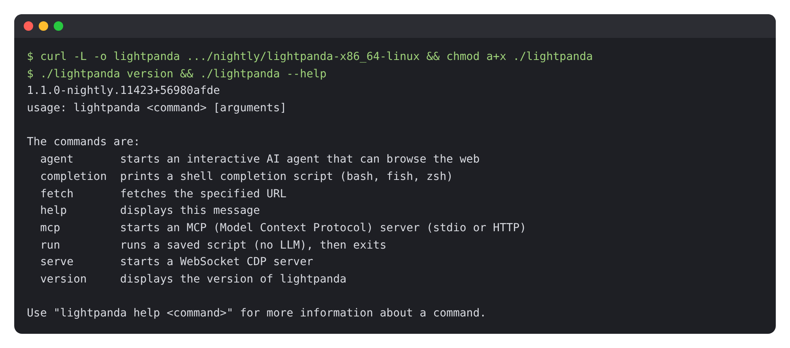
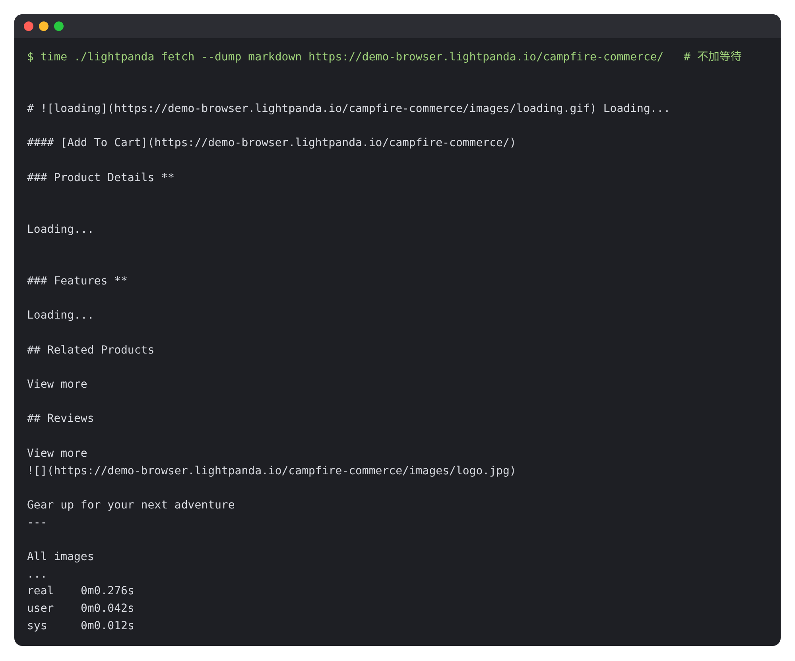
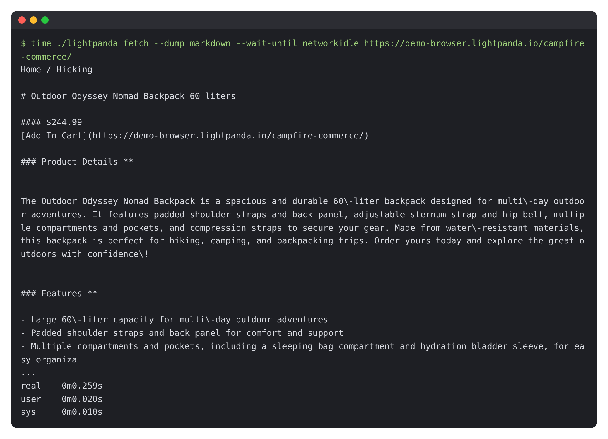
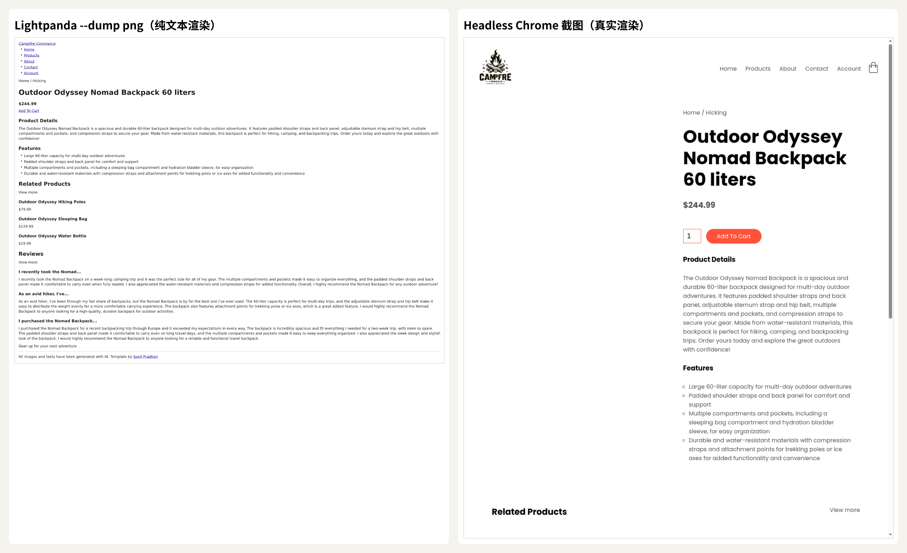
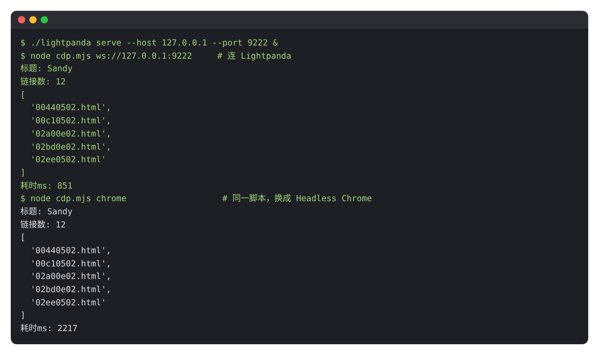

# Lightpanda 中文教程：给 AI 和爬虫用的轻量无头浏览器（实测内存 28MB vs Chrome 1.2GB）

> **非官方中文教程**。原项目 [lightpanda-io/browser](https://github.com/lightpanda-io/browser)（AGPL-3.0，Lightpanda / Selecy SAS），本仓库与原作者无关。

📚 免费版讲“是什么、和 Chrome 有什么不同、怎么装、怎么抓第一个页面、怎么用 Puppeteer 连上它”。完整版（Chrome 对比实测、PandaScript、MCP 接 AI agent、真实网站测试、局限和踩坑、AGPL 注意事项）在知识星球「开源抢先站」：[https://t.zsxq.com/mc4td](https://t.zsxq.com/mc4td)

🎟️ 首发 6 折：新人先领 20 元券，50 元变 30 元（限 50 张，11 月 29 日截止）👉 [领券](https://t.zsxq.com/jk0TT)

> 适用版本：nightly `1.1.0-nightly.11423+56980afde`｜实测日期：2026-11-01｜实测环境：Linux x86_64，Node 22 + puppeteer-core，对照 Chrome 156  
> 文中终端输出和截图都来自真机实测，不是 README 的翻译。没实测的部分标了「⚠️ 未实测」。

## 目录

- [0. 先说结论：值不值得用？](#0-先说结论值不值得用)
- [1. 它到底是什么？和 Chrome 有什么不一样？](#1-它到底是什么和-chrome-有什么不一样)
- [2. 安装和第一次抓取](#2-安装和第一次抓取)
- [3. 用 Puppeteer 连上它（CDP 模式）](#3-用-puppeteer-连上它cdp-模式)
- [4. 完整版还讲了什么](#4-完整版还讲了什么)
- [来源与许可](#来源与许可)

---

## 0. 先说结论：值不值得用？

写爬虫、做 AI agent 上网、跑自动化测试，大家默认都是“起一个 Headless Chrome”。问题是 Chrome 太重：一个实例动辄几百 MB 到上 GB 内存，启动慢，开几十个并发服务器就扛不住。

**Lightpanda 是一个从零用 Zig 写的无头浏览器**，不是 Chromium 套壳。它有 V8 能跑 JavaScript、有 DOM、能发 XHR/fetch，但**不做排版和绘制**（不算 CSS 布局、不画像素）。省下这部分，就换来了极小的内存和很快的速度。它对外提供 Chrome 同款的 CDP 协议，所以 Puppeteer / Playwright 脚本基本只改一行连接地址就能切过来。

我的实测结论：

- **省内存是真的。** 同一个 Puppeteer 脚本连续抓 13 个页面：Lightpanda 峰值约 **28 MB**，Headless Chrome 约 **1237 MB**（多进程 RSS 合计，有重复计算，但量级差距很明显）。速度 10.7 秒 vs 14.3 秒，快了约 25%，主要耗时在网络上（完整版第 4 节）。
- **CDP 兼容好用。** README 里的 Puppeteer 示例，我只把 `launch()` 换成 `connect({browserWSEndpoint})`，结果和 Chrome 完全一样（第 3 节）。
- **一行命令把网页转 Markdown，很适合喂给大模型。** `lightpanda fetch --dump markdown` 0.26 秒拿到一个 JS 渲染的商品页正文（第 2 节）。**但一定要加 `--wait-until networkidle`**，不然拿到的全是“Loading...”，这是我踩的第一个坑。
- **自带 MCP 服务器，39 个工具**，Claude Code / Cursor 这类 agent 直接接上就能“上网”（完整版第 6 节）。
- **它不是万能的。** 没有真实渲染，`--dump png` 只是“纯文本版截图”；依赖布局计算、Canvas、WebGL 的网站和需要视觉验证码的场景用不了；协议是 **AGPL-3.0**，拿来做对外服务要注意开源义务（完整版第 8 节）。

一句话：**需要“读网页、点按钮、抽数据”而不需要“看网页长什么样”的场景，优先试 Lightpanda。**

---

## 1. 它到底是什么？和 Chrome 有什么不一样？

| 对比项 | Headless Chrome | Lightpanda |
|---|---|---|
| 来源 | Chromium 本体的无头模式 | 从零用 Zig 写，JS 引擎用 V8，HTML 解析用 html5ever |
| 排版 / 绘制 | 完整（CSS 布局、GPU 合成） | 不做，只有 DOM + JS |
| 内存（本文实测 13 页） | 约 1237 MB | 约 28 MB |
| 自动化协议 | CDP、WebDriver BiDi | CDP、WebDriver BiDi（实验） |
| 截图 | 真实像素 | 只有纯文本渲染的 png/pdf |
| 额外能力 | — | 内置转 Markdown、结构化数据、MCP 服务器、AI agent、PandaScript |
| 许可 | BSD 等 | AGPL-3.0 |

它提供 7 个子命令：`fetch`（抓一个页面）、`serve`（起 CDP 服务）、`mcp`（起 MCP 服务）、`agent`（让大模型驱动浏览器）、`run`（回放脚本）、`completion`、`version`。

---

## 2. 安装和第一次抓取

### 2.1 下载二进制（Linux / macOS）

官方没有正式版，只有每天更新的 nightly。Linux x86_64：

```bash
curl -L -o lightpanda https://github.com/lightpanda-io/browser/releases/download/nightly/lightpanda-x86_64-linux
chmod a+x ./lightpanda
./lightpanda version
```

macOS Apple 芯片把文件名换成 `lightpanda-aarch64-macos`；也可以 `brew install lightpanda-io/browser/lightpanda`。Windows 没有原生版本，要在 WSL2 里按 Linux 装（⚠️ 未实测 macOS、Homebrew、WSL、Docker 这几种装法）。



> 注：Linux 二进制依赖 glibc 2.35+（arm64 要 2.38+），Alpine 这类 musl 系统跑不了，会报 `cannot execute: required file not found`。

**关掉遥测**：默认会上报使用数据，建议在 `~/.bashrc` 里加一行：

```bash
export LIGHTPANDA_DISABLE_TELEMETRY=true
```

### 2.2 一行命令把网页转成 Markdown

官方提供了一个演示商品页，页面内容是 JS 异步加载的。先直接抓：



**踩坑**：商品名、价格、详情全是 `Loading...`。原因是 `fetch` 默认在页面 load 事件后就导出，这时异步请求还没回来。加上 `--wait-until networkidle`（等网络空闲再导出）就对了：



0.26 秒拿到干净的 Markdown：标题、价格、详情、特性、相关商品都在，直接能喂给大模型。

`--dump` 还能选：`html`（JS 执行后的 DOM）、`markdown`、`structured_data`（JSON-LD、OpenGraph、meta 标签的 JSON）、`png` / `pdf`。等待条件除了 `--wait-until`，还有 `--wait-ms`、`--wait-selector`（等某个元素出现）、`--wait-script`（等一段 JS 返回真）。

### 2.3 png 截图不是你以为的截图

`--dump png` 输出的是“纯文本渲染”：没有 CSS、没有图片，只有文字和结构。下面左边是 Lightpanda，右边是同一页面的 Chrome 截图：



所以要做视觉回归测试、给页面拍“长什么样”的截图，还是得用 Chrome。

---

## 3. 用 Puppeteer 连上它（CDP 模式）

起一个 CDP 服务：

```bash
./lightpanda serve --host 127.0.0.1 --port 9222
```

然后把 Puppeteer 脚本里的 `puppeteer.launch()` 换成 `puppeteer.connect()`，其他代码不用动。我的测试脚本 `cdp.mjs`（打开演示页，读出所有链接）：

```js
import puppeteer from 'puppeteer-core';
const browser = await puppeteer.connect({ browserWSEndpoint: 'ws://127.0.0.1:9222' });
const ctx = await browser.createBrowserContext();
const page = await ctx.newPage();
await page.goto('https://demo-browser.lightpanda.io/amiibo/', { waitUntil: 'networkidle0' });
const links = await page.evaluate(() =>
  Array.from(document.querySelectorAll('a')).map(a => a.getAttribute('href')));
console.log(await page.title(), links.length);
await page.close(); await ctx.close(); await browser.disconnect();
```

同一份脚本分别连 Lightpanda 和启动 Chrome，结果一模一样：



注意两点：

- 结束时用 `browser.disconnect()`，不是 `close()`，服务进程会继续跑，可以接下一个连接。
- 安装 `puppeteer-core` 就够了，不需要 `puppeteer`（后者会再下载一个 Chrome）。

Playwright 用 `chromium.connectOverCDP('ws://127.0.0.1:9222')` 连接（⚠️ 未实测 Playwright）。要用 WebDriver BiDi，启动时加 `--protocol webdriver`（⚠️ 未实测）。

---

## 4. 完整版还讲了什么

| 章节 | 一句话简介 |
|---|---|
| 实测：到底省多少 | 同一个 Puppeteer 脚本抓 13 个页面，Lightpanda 和 Chrome 156 的耗时、峰值内存对比，以及为什么和官方数据有差距 |
| PandaScript | 不装 Node 也能跑的抓取脚本，`page.extract` 一次抽多个字段，agent 录制再回放的思路 |
| 接给 AI agent | MCP 配置、39 个工具逐个说明、HTTP 多会话模式 |
| 真实网站能跑吗 | react.dev、B 站、GitHub Trending 实测，`--obey-robots` 的行为 |
| 局限和踩坑 | 没有排版引擎意味着什么、哪些网站用不了、“Lightpanda 优先 Chrome 兜底”的写法、AGPL-3.0 要注意什么 |
| 实测清单 | 哪些测了、哪些没测，一张表说清楚 |

---

## 加入知识星球「开源抢先站」看完整版

Chrome 对比实测、MCP 接 agent、真实网站测试、踩坑排错：[https://t.zsxq.com/mc4td](https://t.zsxq.com/mc4td)


🎟️ 首发 6 折新人券（20 元，限 50 张，2026-11-29 截止）：[https://t.zsxq.com/jk0TT](https://t.zsxq.com/jk0TT)，先领券再加入更划算。

---

## 来源与许可

- 原项目：<https://github.com/lightpanda-io/browser>（实测版本 nightly `1.1.0-nightly.11423+56980afde`，源码 `813e0fb`）
- 原项目采用 **GNU AGPL-3.0-only 许可**，Copyright (C) 2023-2026 Lightpanda (Selecy SAS)。本教程是独立撰写的非官方使用教程，不是官方文档，与 Lightpanda 没有隶属或背书关系；文中引用的命令、参数和少量英文原文属于原项目，版权归原作者所有。“Lightpanda”名称和标志归其所有者。
- 第 1 节表格里的内存数据为本文实测；官方基准数据来自原项目 README。演示页面 demo-browser.lightpanda.io 由 Lightpanda 提供；Hacker News、react.dev、bilibili、GitHub 页面内容版权归各自网站。
- 文中 `cdp.mjs`、`crawl.mjs`、`hn.js` 是本教程作者写的测试脚本（`cdp.mjs` 改编自官方 README 示例）。
- 本教程的文字与图片采用 [CC BY-NC-SA 4.0](LICENSE.md) 许可。
